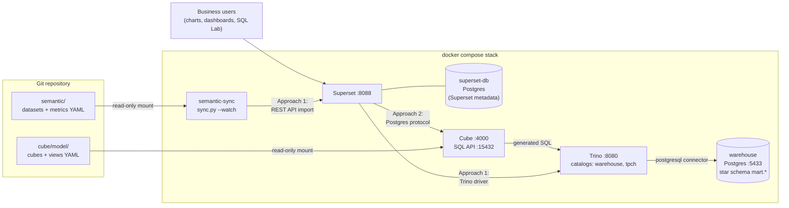
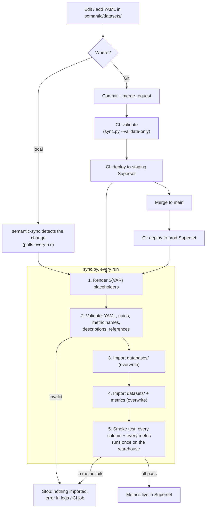
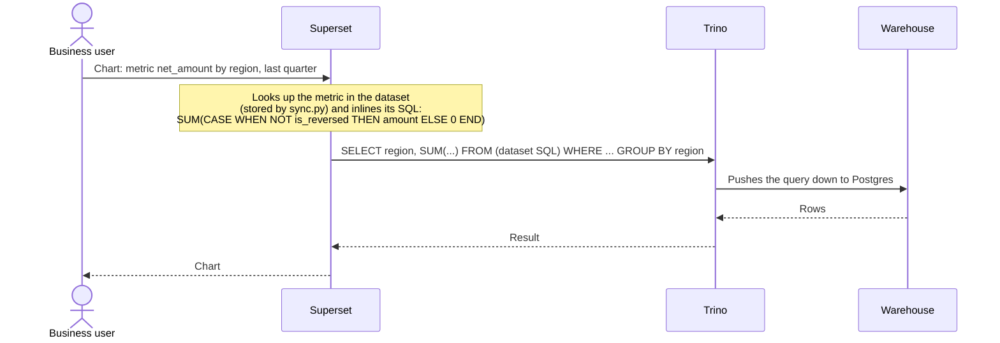
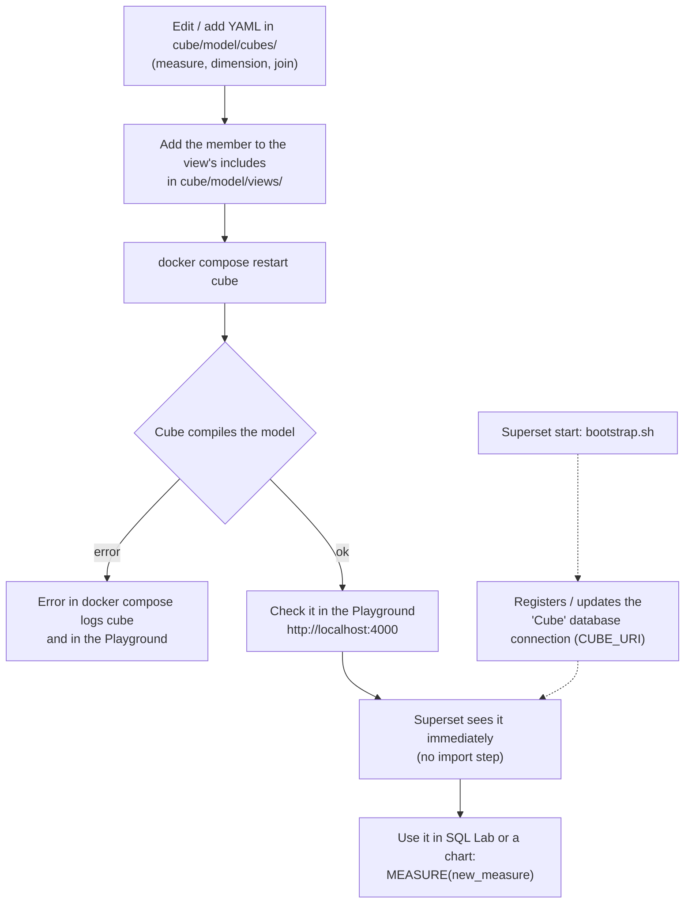
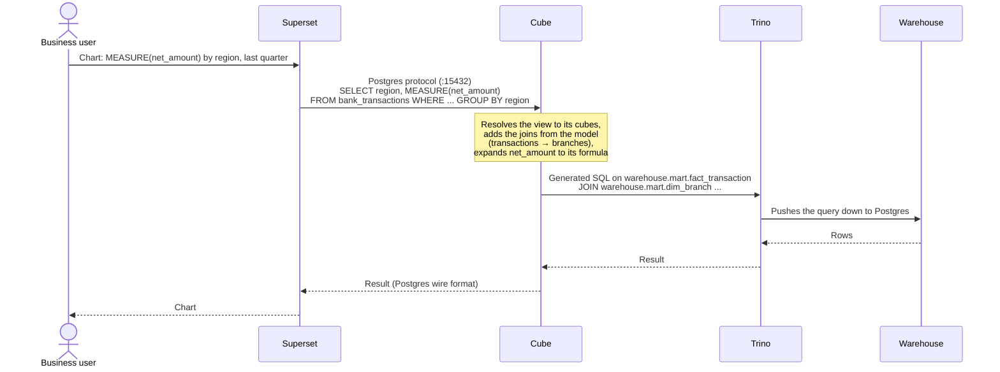

# Semantic layer POC: Superset native vs. Cube

This repo runs two ways of defining business metrics (net amount, reversal rate,
active customers, ...) once and using them in Superset, side by side on the same
Trino warehouse:

| | Approach 1: Native semantic layer | Approach 2: External semantic layer (Cube) |
|---|---|---|
| Where metrics live | Superset datasets, as YAML in `semantic/` | Cube data model, as YAML in `cube/model/` |
| How they reach Superset | `sync.py` imports them through the Superset REST API | Superset queries Cube live through a database connection |
| Who runs the SQL | Superset → Trino | Superset → Cube → Trino |
| CI/CD | `.gitlab-ci.yml` validates and deploys | Not in CI; separate from `semantic/` |

```
Approach 1   semantic/*.yaml ──(sync.py)──► Superset datasets + metrics ──────────► Trino ──► warehouse
Approach 2   cube/model/*.yml ──► Cube ◄──(SQL API, Postgres protocol)── Superset
                                   └──────────────────────────────────────────► Trino ──► warehouse
```

## Architecture

Everything runs in one `docker compose` stack. Both approaches share Superset,
Trino and the warehouse; they differ in where the metric definitions live and
how Superset gets them.



| Component | Role | Approach |
|---|---|---|
| `semantic-sync` | Watches `semantic/`, validates, imports datasets and metrics into Superset, smoke-tests them | 1 |
| Superset | BI tool. Approach 1: holds the metrics. Approach 2: only queries Cube | both |
| `superset-db` | Superset's own metadata (users, charts, datasets, the imported metrics) | both |
| Cube | External semantic layer: reads `cube/model/`, turns semantic queries into Trino SQL | 2 |
| Trino | Query engine in front of the warehouse (and any future source) | both |
| `warehouse` | Sample banking star schema (`fact_transaction` + `dim_*`), stand-in for the bank's warehouse | both |

## Layout

| Path | What it is |
|---|---|
| `semantic/metadata.yaml` | Approach 1: bundle header Superset expects (`type: SqlaTable`) |
| `semantic/databases/*.yaml` | Approach 1: warehouse connection; URI comes from `${TRINO_URI}` |
| `semantic/datasets/<db>/*.yaml` | Approach 1: one file per dataset: table or SQL, columns, **metrics** |
| `sync/sync.py` | Approach 1: render `${VAR}` → validate → import databases, then datasets (overwrite) → smoke test (columns + every metric) |
| `.gitlab-ci.yml` | Approach 1: validate on MR, deploy to staging on MR, deploy to prod on merge |
| `cube/model/cubes/*.yml` | Approach 2: one cube per warehouse table: dimensions, measures, joins |
| `cube/model/views/*.yml` | Approach 2: what Superset sees: flat "tables" assembled from the cubes |
| `superset/` | Superset image (Postgres + Trino drivers), config, bootstrap (also registers the Cube connection) |
| `trino/catalog/` | Trino catalogs: `warehouse` (sample star schema) and `tpch` (built-in sample) |
| `warehouse/init/` | Sample banking star schema loaded into the `warehouse` Postgres |

## Run locally

Create `.env` in the repo root (never commit it):

| Variable | Used by |
|---|---|
| `SUPERSET_VERSION`, `TRINO_VERSION` | Image versions (defaults: `6.0.0`, `476`) |
| `SUPERSET_SECRET_KEY`, `SUPERSET_DB_PASSWORD` | Superset |
| `SUPERSET_ADMIN_USERNAME`, `SUPERSET_ADMIN_PASSWORD` | Superset admin; also used by `sync.py` |
| `WAREHOUSE_DB_PASSWORD` | Sample warehouse Postgres, read by Trino |
| `CUBE_API_SECRET` | Cube (signs API tokens) |
| `CUBE_SQL_PASSWORD` | Cube SQL API password; Superset's Cube connection uses it |
| `GIT_REPO_URL` | Optional: shown as each dataset's source link |

```bash
docker compose up -d --build
docker compose logs -f semantic-sync
```

| URL | What |
|---|---|
| http://localhost:8088 | Superset |
| http://localhost:4000 | Cube Playground: browse the model, run queries, see the SQL Cube generates |
| http://localhost:8080 | Trino |
| `localhost:5433` | Sample warehouse Postgres (DBeaver) |
| `localhost:15432` | Cube SQL API (Postgres protocol) |

---

## Approach 1: Native semantic layer (Superset datasets as code)

Datasets and metrics live as YAML in `semantic/`. A small sync script pushes them
into Superset through its REST API, locally on every file save, and from CI on
every merge. Nobody imports by hand.

```
semantic/*.yaml ──(git push)──► CI: validate → staging + smoke test → prod
      │
      └─(local, docker compose)──► semantic-sync container (watch) ──► Superset ──► Trino
```

Locally, edit any file in `semantic/`, save, and within a few seconds the sync
container re-imports it. Datasets appear in Superset under **Datasets** with
their metrics, ready for charts.

### Workflow: change a metric



### Workflow: what happens when a chart runs



The metric's SQL is stored inside Superset, so the definition can only be used
by Superset.

### Add or change a metric

1. Edit the dataset file in `semantic/datasets/...` (or add a new file).
2. `docker compose logs semantic-sync` shows `valid`, `imported`, `smoke test passed`.
3. Commit, open a merge request. CI validates and deploys to staging; merge deploys to prod.

### Start from an existing dataset

Build it once in the Superset UI, then **Datasets → ⋮ → Export**. Unzip and
copy `datasets/...yaml` into `semantic/datasets/`, keep its `uuid`, point
`database_uuid` at `semantic/databases/Trino.yaml`, and add descriptions.

### Rules

- **`uuid` never changes.** A new uuid = a new duplicate dataset. A new file needs a new,
  valid uuid (`[guid]::NewGuid()` in PowerShell).
- **One invalid file blocks the whole sync.** Superset imports the folder as one bundle;
  if one file fails, nothing is imported. Check `docker compose logs semantic-sync`.
- **Don't rename metrics.** Charts reference metrics by name. Add a new one instead.
- **Deleting a metric in Git deletes it in Superset** (import runs with overwrite +
  sync). Check no chart uses it first.
- **Datasets removed from Git are not deleted** from Superset; remove them manually.
- **Database files are imported separately with overwrite**, because Superset's dataset
  import never updates an existing connection. Changing `${TRINO_URI}` takes effect on the next sync.
- **Credentials never go in Git**: use `${VAR}` placeholders and CI variables, or
  `SUPERSET_DB_PASSWORDS`.
- **Lock editing with permissions.** `is_managed_externally: true` marks the dataset as
  Git-owned, but Superset does not block edits through it. Give business users roles
  without write access to datasets; anything edited anyway is reset on the next deploy.
- Every metric needs `description` and `snake_case` name (enforced by `sync.py`).

---

## Approach 2: External semantic layer (Cube)

[Cube Core](https://cube.dev) is a separate service that owns the business logic.
It reads its YAML model from `cube/model/`, generates SQL for Trino, and serves
the results to any client. Superset is one of those clients: it connects to
Cube's **SQL API**, which speaks the Postgres protocol, so to Superset Cube looks
like a Postgres database whose tables are the Cube views.

This approach is deliberately **separate from `semantic/` and CI/CD**: nothing in
`sync.py` or `.gitlab-ci.yml` touches Cube.

### Workflow: change a measure



### Workflow: what happens when a chart runs



Superset never sees the formula or the joins; it only asks Cube for a measure
by name. Any other client (another BI tool, a notebook, an application) asking
for `net_amount` gets the same SQL and the same number.

### The model

| File | Contents |
|---|---|
| `cubes/transactions.yml` | Fact cube on `warehouse.mart.fact_transaction`: measures (`net_amount`, `transaction_count`, `net_fees`, `avg_txn_amount`, `reversal_rate`, `digital_share`, `active_customers`) and N:1 joins to the dimensions |
| `cubes/dates.yml`, `customers.yml`, `branches.yml`, `products.yml` | Dimension cubes, one per `dim_*` table |
| `views/bank_transactions.yml` | The view Superset uses: transaction measures + date, customer, branch and product dimensions in one flat table |

- **Joins are declared once** in the cube (`relationship: many_to_one`). Cube writes the
  `JOIN`s itself, following each view's `join_path`.
- **Measures can build on measures:** `avg_txn_amount` is `{net_amount} / NULLIF({non_reversed_count}, 0)`.
  Helper measures such as `non_reversed_count` are `public: false`.
- **Cubes are `public: false`**: clients should only use views. (In dev mode Cube still lists
  them; see production notes.)

### Connection from Superset

`superset/bootstrap.sh` registers a database connection named **Cube** on every
Superset start (creates it, or updates its URI). The URI comes from `CUBE_URI`
in the `superset` service in `docker-compose.yml`:

```
postgresql://cube:<CUBE_SQL_PASSWORD>@cube:15432/cube
```

| Part | Value |
|---|---|
| Driver | `postgresql://`: Cube's SQL API speaks the Postgres protocol |
| User | `cube` (`CUBEJS_SQL_USER` in the `cube` service) |
| Password | `CUBE_SQL_PASSWORD` from `.env` |
| Host | `cube` inside Docker; `localhost` from your machine (DBeaver, psql, a local Superset) |
| Port | `15432` (`CUBEJS_PG_SQL_PORT`) |
| Database | `cube` (any name works) |

To connect another Superset by hand: **Settings → Database Connections → + Database
→ PostgreSQL**, and paste the URI into **SQLAlchemy URI**.

### Use it in Superset

**SQL Lab:** choose database **Cube**, schema **public**. Measures are queried with
`MEASURE()`; dimensions are plain columns:

```sql
SELECT region, MEASURE(net_amount) AS net_amount, MEASURE(digital_share) AS digital_share
FROM bank_transactions
GROUP BY region
ORDER BY 2 DESC
```

**Charts:** **Datasets → + Dataset → Cube → public → bank_transactions**. In a chart,
add metrics as **Custom SQL** with `MEASURE(<measure name>)`, e.g. `MEASURE(net_amount)`.
Dimensions, filters and time grains (`full_date` by month, quarter, ...) work as usual;
Cube translates Superset's `DATE_TRUNC`, `WHERE` and `GROUP BY`.

### Change the model

1. Edit or add files in `cube/model/cubes/` or `cube/model/views/`.
2. `docker compose restart cube`. (Cube's file watcher does not see changes on a
   Windows bind mount.)
3. Check the change in the Playground (http://localhost:4000), then refresh Superset.
   Superset queries Cube live, so there is no import step.

To expose a new measure or dimension to Superset, add it to the cube **and** to the
view's `includes` list.

---

## Pros and cons

### Approach 1: Native semantic layer

**Pros**
- **Fewer moving parts.** Superset and Trino only; nothing extra to run, secure or monitor.
- **Full Superset feature set.** Any Trino SQL in metrics and virtual datasets (window
  functions, CTEs, `approx_percentile`, ...), SQL Lab, drill-down, cross-filters.
- **Metrics are first-class in Superset.** Business users pick `net_amount` from a list
  with its label, description and number format; no SQL needed in charts.
- **Governed delivery is already built.** Git → validate → staging → smoke test → prod.
  A metric or column that does not run on the warehouse fails the deploy, not a dashboard.
- **Easy to adopt.** A dataset can be built in the UI, exported and committed.

**Cons**
- **Superset only.** The definitions cannot be reused by Power BI, Excel, Python
  notebooks, applications or AI agents; each would redefine the same numbers.
- **No join graph.** Joins are hand-written in each virtual dataset's SQL, and the
  author must avoid fan-out (double counting) every time.
- **Repetition across datasets.** The same rule (e.g. "exclude reversed transactions")
  is copied into every dataset that needs it (`transactions`, `customers`,
  `branch_monthly`, ...). Changing it means editing every copy.
- **Metrics cannot reference other metrics**; each is a standalone SQL expression.
- **No acceleration layer.** Only Superset's result cache; heavy queries always hit Trino.
- **Clean-up is manual.** Datasets removed from Git stay in Superset.

### Approach 2: External semantic layer (Cube)

**Pros**
- **Define once, use everywhere.** The same measures are served over SQL (Postgres
  protocol), REST and GraphQL to Superset, other BI tools, notebooks and applications.
- **Real data model.** Relationships are declared once; Cube generates the joins for
  each query, and views compose cubes without hand-written SQL.
- **Composable measures.** Ratios and averages are built from other measures
  (`avg_txn_amount = net_amount / non_reversed_count`), so a rule lives in one place.
- **Changes are live.** Edit the model, restart Cube, and every client sees the new
  definition; no import into Superset.
- **Performance and security features** available when needed: pre-aggregations
  (stored in Cube Store) and row-level access rules in the model that apply to every
  client, not just Superset. (Not configured in this POC.)

**Cons**
- **Another service to run.** Production needs dev mode off, Cube Store, real
  authentication, monitoring and high availability. It also adds a hop between
  Superset and Trino.
- **Shallower Superset integration.** Superset sees Cube views as plain tables: measure
  titles, descriptions and formats from Cube do not appear in Superset, and chart
  authors write `MEASURE(...)` as Custom SQL (or someone maintains Superset datasets on
  top of the views).
- **Restricted SQL.** Only queries Cube can map to its model are accepted. Free-form SQL
  on Cube (e.g. window functions or Superset virtual datasets over the views) may be
  rejected; such logic belongs in the Cube model.
- **Not in CI/CD here.** The Cube model has no validation, smoke test or staged deploy
  in this repo, and Superset datasets built on Cube views in the UI are not in Git.
- **New skill set.** The team has to learn Cube's modeling language and debug
  through the SQL Cube generates (visible in the Playground).

### When to choose which

- **Native** fits when Superset is the only consumer and the team wants the
  smallest, already-automated setup.
- **Cube** fits when several tools or applications must show the same numbers, when
  the model has many joined tables, or when pre-aggregation or central row-level
  security is needed, and the team can operate one more service.

---

## Production notes

**Both approaches**
- Pin `SUPERSET_VERSION` / `TRINO_VERSION` (and `CUBE_VERSION`, default `v1.8.6`) to
  what the bank runs.

**Native**
- Use a dedicated service account for CI. Set `SUPERSET_AUTH_PROVIDER=ldap` if
  Superset authenticates against LDAP. OAuth-only logins can't be used by the script.

**Cube**
- **Turn off dev mode** (`CUBEJS_DEV_MODE=false`). Dev mode disables authentication,
  enables the Playground, and lists `public: false` cubes. With it off, only views are
  exposed through the SQL API.
- **Run Cube Store** (`cubejs/cubestore`) and set `CUBEJS_CUBESTORE_HOST` /
  `CUBEJS_CUBESTORE_PORT`. Without dev mode, queries fail if no Cube Store is configured.
- Use a strong `CUBE_API_SECRET` and `CUBE_SQL_PASSWORD`, and give Cube a dedicated
  Trino user (`CUBEJS_DB_USER`) with read-only access.
